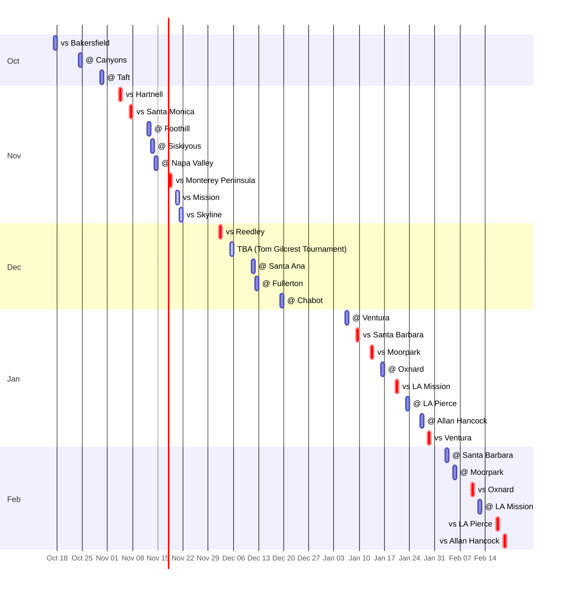

# 🏀 Cuesta College Women's Basketball — 2026-27

**[🌐 Live schedule](https://johnlinwiz.github.io/cuesta-basketball/?team=wbb)** (table · [calendar](https://johnlinwiz.github.io/cuesta-basketball/?team=wbb#calendar) · [map](https://johnlinwiz.github.io/cuesta-basketball/?team=wbb#map)) · **[➕ Subscribe (.ics)](https://johnlinwiz.github.io/cuesta-basketball/cuesta-wbb.ics)** · **[🗓️ Month grids](CALENDAR.md)** · **[🗺️ Venue map](../venues.geojson)** · **[🔔 Reminders](https://github.com/johnlinwiz/cuesta-basketball/issues?q=is%3Aissue+label%3Awbb)** · **🖨️ Printable PDF: [colour](https://johnlinwiz.github.io/cuesta-basketball/cuesta-wbb-schedule.pdf) · [black & white](https://johnlinwiz.github.io/cuesta-basketball/cuesta-wbb-schedule-bw.pdf)** · [⬅ All teams](../README.md)

**Record: 1-2**

> **Next up (in 3 days):** Thu Nov 12 · 4:00 PM · @ Foothill — [Foothill College Main Gymnasium](https://www.google.com/maps/search/?api=1&query=Foothill+College+Main+Gymnasium%2C+12345+El+Monte+Rd%2C+Los+Altos+Hills%2C+CA+94022), Los Altos Hills, CA  
> 🚗 Pasadena [6h 40m](https://www.google.com/maps/dir/?api=1&origin=Pasadena%2C+CA&destination=12345+El+Monte+Rd%2C+Los+Altos+Hills%2C+CA+94022&travelmode=driving) · 354 mi · SLO [3h 52m](https://www.google.com/maps/dir/?api=1&origin=San+Luis+Obispo%2C+CA&destination=12345+El+Monte+Rd%2C+Los+Altos+Hills%2C+CA+94022&travelmode=driving) · 198 mi

🏠 home · 🚌 away · 🏆 tournament · `*` Western State Conference · `?` home/away inferred (poster had no `@`/`Vs`) · ✅ played  
📺 host school's stream channel (the per-game link usually goes up on game day; 📺 maybe = that school rarely streams: Cuesta hasn't posted a men's game since 2020) · 📊 live stats. Drive times are OSRM free-flow estimates (no traffic; run a bit long vs Google) — click one for live Google Maps directions. All times Pacific.

## October 2026

| Date | Time | Game | H/A | Venue | 🚗 From Pasadena | 🚗 From SLO | 🔔 |
|---|---|---|---|---|---|---|---|
| ✅ Sat Oct 17 | 11:30 AM | 📍 **vs Bakersfield** scrimmage · Taft College Jamboree | Neutral | [Taft College Gym](https://www.google.com/maps/search/?api=1&query=Taft+College+Gym%2C+29+Cougar+Court%2C+Taft%2C+CA+93268) Taft, CA | [2h 28m](https://www.google.com/maps/dir/?api=1&origin=Pasadena%2C+CA&destination=29+Cougar+Court%2C+Taft%2C+CA+93268&travelmode=driving) · 121 mi | [2h 12m](https://www.google.com/maps/dir/?api=1&origin=San+Luis+Obispo%2C+CA&destination=29+Cougar+Court%2C+Taft%2C+CA+93268&travelmode=driving) · 96 mi |  |
| ✅ Sat Oct 24 | 2:00 PM | 🚌 **@ Canyons** scrimmage | Away | [College of the Canyons — Lee Smelser Court (Cougar Cage)](https://www.google.com/maps/search/?api=1&query=College+of+the+Canyons+%E2%80%94+Lee+Smelser+Court+%28Cougar+Cage%29%2C+26455+Rockwell+Canyon+Road%2C+Santa+Clarita%2C+CA+91355) Santa Clarita, CA | [41m](https://www.google.com/maps/dir/?api=1&origin=Pasadena%2C+CA&destination=26455+Rockwell+Canyon+Road%2C+Santa+Clarita%2C+CA+91355&travelmode=driving) · 35 mi | [3h 32m](https://www.google.com/maps/dir/?api=1&origin=San+Luis+Obispo%2C+CA&destination=26455+Rockwell+Canyon+Road%2C+Santa+Clarita%2C+CA+91355&travelmode=driving) · 169 mi |  |
| ✅ Fri Oct 30 | 5:00 PM | 🚌 **@ Taft** 🔴 **L 58-66** · [box](https://www.cccaasports.org/links/djm9mg) | Away | [Taft College Gym](https://www.google.com/maps/search/?api=1&query=Taft+College+Gym%2C+29+Cougar+Court%2C+Taft%2C+CA+93268) Taft, CA | [2h 28m](https://www.google.com/maps/dir/?api=1&origin=Pasadena%2C+CA&destination=29+Cougar+Court%2C+Taft%2C+CA+93268&travelmode=driving) · 121 mi | [2h 12m](https://www.google.com/maps/dir/?api=1&origin=San+Luis+Obispo%2C+CA&destination=29+Cougar+Court%2C+Taft%2C+CA+93268&travelmode=driving) · 96 mi |  |

## November 2026

| Date | Time | Game | H/A | Venue | 🚗 From Pasadena | 🚗 From SLO | 🔔 |
|---|---|---|---|---|---|---|---|
| ✅ Wed Nov 4 | 3:00 PM | 🏠 **vs Hartnell** 🔴 **L 51-67** · [box](https://www.cccaasports.org/sports/wbkb/2026-27/boxscores/20261104_hvlu.xml) | Home | [Stork Gymnasium (Cuesta Gym)](https://www.google.com/maps/search/?api=1&query=Stork+Gymnasium+%28Cuesta+Gym%29%2C+Cuesta+College%2C+Highway+1%2C+San+Luis+Obispo%2C+CA+93405) San Luis Obispo, CA | [4h 03m](https://www.google.com/maps/dir/?api=1&origin=Pasadena%2C+CA&destination=Cuesta+College%2C+Highway+1%2C+San+Luis+Obispo%2C+CA+93405&travelmode=driving) · 198 mi | [12m](https://www.google.com/maps/dir/?api=1&origin=San+Luis+Obispo%2C+CA&destination=Cuesta+College%2C+Highway+1%2C+San+Luis+Obispo%2C+CA+93405&travelmode=driving) · 7 mi |  |
| ✅ Sat Nov 7 | 1:00 PM | 🏠 **vs Santa Monica** 🟢 **W 65-50** · [box](https://www.cccaasports.org/sports/wbkb/2026-27/boxscores/20261107_af5x.xml) | Home | [Stork Gymnasium (Cuesta Gym)](https://www.google.com/maps/search/?api=1&query=Stork+Gymnasium+%28Cuesta+Gym%29%2C+Cuesta+College%2C+Highway+1%2C+San+Luis+Obispo%2C+CA+93405) San Luis Obispo, CA | [4h 03m](https://www.google.com/maps/dir/?api=1&origin=Pasadena%2C+CA&destination=Cuesta+College%2C+Highway+1%2C+San+Luis+Obispo%2C+CA+93405&travelmode=driving) · 198 mi | [12m](https://www.google.com/maps/dir/?api=1&origin=San+Luis+Obispo%2C+CA&destination=Cuesta+College%2C+Highway+1%2C+San+Luis+Obispo%2C+CA+93405&travelmode=driving) · 7 mi | [#31](https://github.com/johnlinwiz/cuesta-basketball/issues/31) |
| Thu Nov 12 | 4:00 PM | 🚌 **@ Foothill** | Away | [Foothill College Main Gymnasium](https://www.google.com/maps/search/?api=1&query=Foothill+College+Main+Gymnasium%2C+12345+El+Monte+Rd%2C+Los+Altos+Hills%2C+CA+94022) Los Altos Hills, CA | [6h 40m](https://www.google.com/maps/dir/?api=1&origin=Pasadena%2C+CA&destination=12345+El+Monte+Rd%2C+Los+Altos+Hills%2C+CA+94022&travelmode=driving) · 354 mi | [3h 52m](https://www.google.com/maps/dir/?api=1&origin=San+Luis+Obispo%2C+CA&destination=12345+El+Monte+Rd%2C+Los+Altos+Hills%2C+CA+94022&travelmode=driving) · 198 mi | [#32](https://github.com/johnlinwiz/cuesta-basketball/issues/32) |
| Fri Nov 13 | 2:00 PM | 🚌 **@ Siskiyous** [📺 watch](https://fan.hudl.com/United-States/CA/Weed/organization/4884/College-of-the-Siskiyous-/video) | Away | [Siskiyous Gymnasium](https://www.google.com/maps/search/?api=1&query=Siskiyous+Gymnasium%2C+800+College+Avenue%2C+Weed%2C+CA+96094) Weed, CA | [11h 16m](https://www.google.com/maps/dir/?api=1&origin=Pasadena%2C+CA&destination=800+College+Avenue%2C+Weed%2C+CA+96094&travelmode=driving) · 613 mi | [9h 25m](https://www.google.com/maps/dir/?api=1&origin=San+Luis+Obispo%2C+CA&destination=800+College+Avenue%2C+Weed%2C+CA+96094&travelmode=driving) · 496 mi | [#33](https://github.com/johnlinwiz/cuesta-basketball/issues/33) |
| Sat Nov 14 | 2:00 PM | 🚌 **@ Napa Valley** | Away | [Napa Valley College Gym](https://www.google.com/maps/search/?api=1&query=Napa+Valley+College+Gym%2C+2277+Napa-Vallejo+Hwy%2C+Napa%2C+CA+94558) Napa, CA | [7h 24m](https://www.google.com/maps/dir/?api=1&origin=Pasadena%2C+CA&destination=2277+Napa-Vallejo+Hwy%2C+Napa%2C+CA+94558&travelmode=driving) · 398 mi | [5h 07m](https://www.google.com/maps/dir/?api=1&origin=San+Luis+Obispo%2C+CA&destination=2277+Napa-Vallejo+Hwy%2C+Napa%2C+CA+94558&travelmode=driving) · 262 mi | [#34](https://github.com/johnlinwiz/cuesta-basketball/issues/34) |
| Wed Nov 18 | 4:00 PM | 🏠 **vs Monterey Peninsula** [📺 maybe](https://www.youtube.com/channel/UCJ5AEH02wtWXIUFAgVMspnQ) | Home | [Stork Gymnasium (Cuesta Gym)](https://www.google.com/maps/search/?api=1&query=Stork+Gymnasium+%28Cuesta+Gym%29%2C+Cuesta+College%2C+Highway+1%2C+San+Luis+Obispo%2C+CA+93405) San Luis Obispo, CA | [4h 03m](https://www.google.com/maps/dir/?api=1&origin=Pasadena%2C+CA&destination=Cuesta+College%2C+Highway+1%2C+San+Luis+Obispo%2C+CA+93405&travelmode=driving) · 198 mi | [12m](https://www.google.com/maps/dir/?api=1&origin=San+Luis+Obispo%2C+CA&destination=Cuesta+College%2C+Highway+1%2C+San+Luis+Obispo%2C+CA+93405&travelmode=driving) · 7 mi | [#35](https://github.com/johnlinwiz/cuesta-basketball/issues/35) |
| Fri Nov 20 | 6:00 PM | 🏆 **vs Mission** [📺 maybe](https://www.youtube.com/channel/UCJ5AEH02wtWXIUFAgVMspnQ) Hinson's Tire Pros Classic, day 1 | Home | [Stork Gymnasium (Cuesta Gym)](https://www.google.com/maps/search/?api=1&query=Stork+Gymnasium+%28Cuesta+Gym%29%2C+Cuesta+College%2C+Highway+1%2C+San+Luis+Obispo%2C+CA+93405) San Luis Obispo, CA | [4h 03m](https://www.google.com/maps/dir/?api=1&origin=Pasadena%2C+CA&destination=Cuesta+College%2C+Highway+1%2C+San+Luis+Obispo%2C+CA+93405&travelmode=driving) · 198 mi | [12m](https://www.google.com/maps/dir/?api=1&origin=San+Luis+Obispo%2C+CA&destination=Cuesta+College%2C+Highway+1%2C+San+Luis+Obispo%2C+CA+93405&travelmode=driving) · 7 mi | [#36](https://github.com/johnlinwiz/cuesta-basketball/issues/36) |
| Sat Nov 21 | 3:00 PM | 🏆 **vs Skyline** [📺 maybe](https://www.youtube.com/channel/UCJ5AEH02wtWXIUFAgVMspnQ) Hinson's Tire Pros Classic, day 2 | Home | [Stork Gymnasium (Cuesta Gym)](https://www.google.com/maps/search/?api=1&query=Stork+Gymnasium+%28Cuesta+Gym%29%2C+Cuesta+College%2C+Highway+1%2C+San+Luis+Obispo%2C+CA+93405) San Luis Obispo, CA | [4h 03m](https://www.google.com/maps/dir/?api=1&origin=Pasadena%2C+CA&destination=Cuesta+College%2C+Highway+1%2C+San+Luis+Obispo%2C+CA+93405&travelmode=driving) · 198 mi | [12m](https://www.google.com/maps/dir/?api=1&origin=San+Luis+Obispo%2C+CA&destination=Cuesta+College%2C+Highway+1%2C+San+Luis+Obispo%2C+CA+93405&travelmode=driving) · 7 mi | [#37](https://github.com/johnlinwiz/cuesta-basketball/issues/37) |

## December 2026

| Date | Time | Game | H/A | Venue | 🚗 From Pasadena | 🚗 From SLO | 🔔 |
|---|---|---|---|---|---|---|---|
| Wed Dec 2 | 5:00 PM | 🏠 **vs Reedley** [📺 maybe](https://www.youtube.com/channel/UCJ5AEH02wtWXIUFAgVMspnQ) | Home | [Stork Gymnasium (Cuesta Gym)](https://www.google.com/maps/search/?api=1&query=Stork+Gymnasium+%28Cuesta+Gym%29%2C+Cuesta+College%2C+Highway+1%2C+San+Luis+Obispo%2C+CA+93405) San Luis Obispo, CA | [4h 03m](https://www.google.com/maps/dir/?api=1&origin=Pasadena%2C+CA&destination=Cuesta+College%2C+Highway+1%2C+San+Luis+Obispo%2C+CA+93405&travelmode=driving) · 198 mi | [12m](https://www.google.com/maps/dir/?api=1&origin=San+Luis+Obispo%2C+CA&destination=Cuesta+College%2C+Highway+1%2C+San+Luis+Obispo%2C+CA+93405&travelmode=driving) · 7 mi | [#38](https://github.com/johnlinwiz/cuesta-basketball/issues/38) |
| Sat Dec 5 | TBA | 🏆 **TBA (Tom Gilcrest Tournament)** [📺 watch](https://www.youtube.com/c/cosgiant) College of the Sequoias' 49th Tom Gilcrest Tournament (Dec 3-5); opponent and time not announced yet | Neutral | [College of the Sequoias — Porter Fieldhouse](https://www.google.com/maps/search/?api=1&query=College+of+the+Sequoias+%E2%80%94+Porter+Fieldhouse%2C+915+S.+Mooney+Blvd%2C+Visalia%2C+CA+93277) Visalia, CA | [3h 28m](https://www.google.com/maps/dir/?api=1&origin=Pasadena%2C+CA&destination=915+S.+Mooney+Blvd%2C+Visalia%2C+CA+93277&travelmode=driving) · 182 mi | [2h 50m](https://www.google.com/maps/dir/?api=1&origin=San+Luis+Obispo%2C+CA&destination=915+S.+Mooney+Blvd%2C+Visalia%2C+CA+93277&travelmode=driving) · 135 mi | [#39](https://github.com/johnlinwiz/cuesta-basketball/issues/39) |
| Fri Dec 11 | 6:00 PM | 🚌 **@ Santa Ana** [📺 watch](https://go.flocollege.com/teams/santa-ana-college) | Away | [Santa Ana College — Bill Cook Gymnasium](https://www.google.com/maps/search/?api=1&query=Santa+Ana+College+%E2%80%94+Bill+Cook+Gymnasium%2C+1530+W.+17th+Street%2C+Santa+Ana%2C+CA+92706) Santa Ana, CA | [52m](https://www.google.com/maps/dir/?api=1&origin=Pasadena%2C+CA&destination=1530+W.+17th+Street%2C+Santa+Ana%2C+CA+92706&travelmode=driving) · 36 mi | [4h 31m](https://www.google.com/maps/dir/?api=1&origin=San+Luis+Obispo%2C+CA&destination=1530+W.+17th+Street%2C+Santa+Ana%2C+CA+92706&travelmode=driving) · 220 mi | [#40](https://github.com/johnlinwiz/cuesta-basketball/issues/40) |
| Sat Dec 12 | 1:00 PM | 🚌 **@ Fullerton** [📺 watch](https://www.flocollege.com/live/284079) (game) Stream is on FloCollege (subscription) | Away | [Fullerton College — The Hornets Nest](https://www.google.com/maps/search/?api=1&query=Fullerton+College+%E2%80%94+The+Hornets+Nest%2C+321+E.+Chapman+Ave%2C+Fullerton%2C+CA+92832) Fullerton, CA | [45m](https://www.google.com/maps/dir/?api=1&origin=Pasadena%2C+CA&destination=321+E.+Chapman+Ave%2C+Fullerton%2C+CA+92832&travelmode=driving) · 31 mi | [4h 24m](https://www.google.com/maps/dir/?api=1&origin=San+Luis+Obispo%2C+CA&destination=321+E.+Chapman+Ave%2C+Fullerton%2C+CA+92832&travelmode=driving) · 215 mi | [#41](https://github.com/johnlinwiz/cuesta-basketball/issues/41) |
| Sat Dec 19 | 3:00 PM | 🚌 **@ Chabot** | Away | [Chabot College Main Gym](https://www.google.com/maps/search/?api=1&query=Chabot+College+Main+Gym%2C+25555+Hesperian+Blvd%2C+Hayward%2C+CA+94545) Hayward, CA | [6h 42m](https://www.google.com/maps/dir/?api=1&origin=Pasadena%2C+CA&destination=25555+Hesperian+Blvd%2C+Hayward%2C+CA+94545&travelmode=driving) · 361 mi | [4h 04m](https://www.google.com/maps/dir/?api=1&origin=San+Luis+Obispo%2C+CA&destination=25555+Hesperian+Blvd%2C+Hayward%2C+CA+94545&travelmode=driving) · 210 mi | [#42](https://github.com/johnlinwiz/cuesta-basketball/issues/42) |

## January 2027

| Date | Time | Game | H/A | Venue | 🚗 From Pasadena | 🚗 From SLO | 🔔 |
|---|---|---|---|---|---|---|---|
| Wed Jan 6 | 5:00 PM | 🚌 **@ Ventura*** [📺 watch](https://www.youtube.com/channel/UCwtRPgwghVQtHQBZAsTmxdQ) | Away | [Ventura College Gym](https://www.google.com/maps/search/?api=1&query=Ventura+College+Gym%2C+4667+Telegraph+Rd%2C+Ventura%2C+CA+93003) Ventura, CA | [1h 24m](https://www.google.com/maps/dir/?api=1&origin=Pasadena%2C+CA&destination=4667+Telegraph+Rd%2C+Ventura%2C+CA+93003&travelmode=driving) · 68 mi | [2h 40m](https://www.google.com/maps/dir/?api=1&origin=San+Luis+Obispo%2C+CA&destination=4667+Telegraph+Rd%2C+Ventura%2C+CA+93003&travelmode=driving) · 126 mi | [#43](https://github.com/johnlinwiz/cuesta-basketball/issues/43) |
| Sat Jan 9 | 1:00 PM | 🏠 **vs Santa Barbara*** [📺 maybe](https://www.youtube.com/channel/UCJ5AEH02wtWXIUFAgVMspnQ) | Home | [Stork Gymnasium (Cuesta Gym)](https://www.google.com/maps/search/?api=1&query=Stork+Gymnasium+%28Cuesta+Gym%29%2C+Cuesta+College%2C+Highway+1%2C+San+Luis+Obispo%2C+CA+93405) San Luis Obispo, CA | [4h 03m](https://www.google.com/maps/dir/?api=1&origin=Pasadena%2C+CA&destination=Cuesta+College%2C+Highway+1%2C+San+Luis+Obispo%2C+CA+93405&travelmode=driving) · 198 mi | [12m](https://www.google.com/maps/dir/?api=1&origin=San+Luis+Obispo%2C+CA&destination=Cuesta+College%2C+Highway+1%2C+San+Luis+Obispo%2C+CA+93405&travelmode=driving) · 7 mi | [#44](https://github.com/johnlinwiz/cuesta-basketball/issues/44) |
| Wed Jan 13 | 5:00 PM | 🏠 **vs Moorpark*** [📺 maybe](https://www.youtube.com/channel/UCJ5AEH02wtWXIUFAgVMspnQ) | Home | [Stork Gymnasium (Cuesta Gym)](https://www.google.com/maps/search/?api=1&query=Stork+Gymnasium+%28Cuesta+Gym%29%2C+Cuesta+College%2C+Highway+1%2C+San+Luis+Obispo%2C+CA+93405) San Luis Obispo, CA | [4h 03m](https://www.google.com/maps/dir/?api=1&origin=Pasadena%2C+CA&destination=Cuesta+College%2C+Highway+1%2C+San+Luis+Obispo%2C+CA+93405&travelmode=driving) · 198 mi | [12m](https://www.google.com/maps/dir/?api=1&origin=San+Luis+Obispo%2C+CA&destination=Cuesta+College%2C+Highway+1%2C+San+Luis+Obispo%2C+CA+93405&travelmode=driving) · 7 mi | [#45](https://github.com/johnlinwiz/cuesta-basketball/issues/45) |
| Sat Jan 16 | 1:00 PM | 🚌 **@ Oxnard*** [📺 watch](https://www.youtube.com/@occondors8165) | Away | [Oxnard College Gym](https://www.google.com/maps/search/?api=1&query=Oxnard+College+Gym%2C+4000+S+Rose+Ave%2C+Oxnard%2C+CA+93033) Oxnard, CA | [1h 19m](https://www.google.com/maps/dir/?api=1&origin=Pasadena%2C+CA&destination=4000+S+Rose+Ave%2C+Oxnard%2C+CA+93033&travelmode=driving) · 63 mi | [2h 50m](https://www.google.com/maps/dir/?api=1&origin=San+Luis+Obispo%2C+CA&destination=4000+S+Rose+Ave%2C+Oxnard%2C+CA+93033&travelmode=driving) · 135 mi | [#46](https://github.com/johnlinwiz/cuesta-basketball/issues/46) |
| Wed Jan 20 | 5:00 PM | 🏠 **vs LA Mission*** [📺 maybe](https://www.youtube.com/channel/UCJ5AEH02wtWXIUFAgVMspnQ) | Home | [Stork Gymnasium (Cuesta Gym)](https://www.google.com/maps/search/?api=1&query=Stork+Gymnasium+%28Cuesta+Gym%29%2C+Cuesta+College%2C+Highway+1%2C+San+Luis+Obispo%2C+CA+93405) San Luis Obispo, CA | [4h 03m](https://www.google.com/maps/dir/?api=1&origin=Pasadena%2C+CA&destination=Cuesta+College%2C+Highway+1%2C+San+Luis+Obispo%2C+CA+93405&travelmode=driving) · 198 mi | [12m](https://www.google.com/maps/dir/?api=1&origin=San+Luis+Obispo%2C+CA&destination=Cuesta+College%2C+Highway+1%2C+San+Luis+Obispo%2C+CA+93405&travelmode=driving) · 7 mi | [#47](https://github.com/johnlinwiz/cuesta-basketball/issues/47) |
| Sat Jan 23 | 1:00 PM | 🚌 **@ LA Pierce*** [📺 watch](https://www.youtube.com/@brahmasportsnetwork) | Away | [LA Pierce College — Ken Stanley Court](https://www.google.com/maps/search/?api=1&query=LA+Pierce+College+%E2%80%94+Ken+Stanley+Court%2C+6201+Winnetka+Ave%2C+Woodland+Hills%2C+CA+91371) Woodland Hills, CA | [35m](https://www.google.com/maps/dir/?api=1&origin=Pasadena%2C+CA&destination=6201+Winnetka+Ave%2C+Woodland+Hills%2C+CA+91371&travelmode=driving) · 27 mi | [3h 27m](https://www.google.com/maps/dir/?api=1&origin=San+Luis+Obispo%2C+CA&destination=6201+Winnetka+Ave%2C+Woodland+Hills%2C+CA+91371&travelmode=driving) · 168 mi | [#48](https://github.com/johnlinwiz/cuesta-basketball/issues/48) |
| Wed Jan 27 | 5:00 PM | 🚌 **@ Allan Hancock*** [📺 watch](https://www.team1sports.com/college/?S=allanhancockcollege) | Away | [Allan Hancock College Gym](https://www.google.com/maps/search/?api=1&query=Allan+Hancock+College+Gym%2C+800+S+College+Dr%2C+Santa+Maria%2C+CA+93454) Santa Maria, CA | [3h 18m](https://www.google.com/maps/dir/?api=1&origin=Pasadena%2C+CA&destination=800+S+College+Dr%2C+Santa+Maria%2C+CA+93454&travelmode=driving) · 160 mi | [42m](https://www.google.com/maps/dir/?api=1&origin=San+Luis+Obispo%2C+CA&destination=800+S+College+Dr%2C+Santa+Maria%2C+CA+93454&travelmode=driving) · 33 mi | [#49](https://github.com/johnlinwiz/cuesta-basketball/issues/49) |
| Fri Jan 29 | 5:00 PM | 🏠 **vs Ventura*** [📺 maybe](https://www.youtube.com/channel/UCJ5AEH02wtWXIUFAgVMspnQ) | Home | [Stork Gymnasium (Cuesta Gym)](https://www.google.com/maps/search/?api=1&query=Stork+Gymnasium+%28Cuesta+Gym%29%2C+Cuesta+College%2C+Highway+1%2C+San+Luis+Obispo%2C+CA+93405) San Luis Obispo, CA | [4h 03m](https://www.google.com/maps/dir/?api=1&origin=Pasadena%2C+CA&destination=Cuesta+College%2C+Highway+1%2C+San+Luis+Obispo%2C+CA+93405&travelmode=driving) · 198 mi | [12m](https://www.google.com/maps/dir/?api=1&origin=San+Luis+Obispo%2C+CA&destination=Cuesta+College%2C+Highway+1%2C+San+Luis+Obispo%2C+CA+93405&travelmode=driving) · 7 mi | [#50](https://github.com/johnlinwiz/cuesta-basketball/issues/50) |

## February 2027

| Date | Time | Game | H/A | Venue | 🚗 From Pasadena | 🚗 From SLO | 🔔 |
|---|---|---|---|---|---|---|---|
| Wed Feb 3 | 5:00 PM | 🚌 **@ Santa Barbara*** [📺 watch](https://fan.hudl.com/usa/ca/santa-barbara/organization/4943/santa-barbara-city/watch?ib=4106831&shared=true) (game) Played at Rob Gym (UCSB), not the SBCC campus | Away | [Robertson Gymnasium ("Rob Gym"), UCSB](https://www.google.com/maps/search/?api=1&query=Robertson+Gymnasium+%28%22Rob+Gym%22%29%2C+UCSB%2C+Robertson+Gymnasium%2C+Ocean+Rd%2C+Santa+Barbara%2C+CA+93106) Santa Barbara, CA | [2h 09m](https://www.google.com/maps/dir/?api=1&origin=Pasadena%2C+CA&destination=Robertson+Gymnasium%2C+Ocean+Rd%2C+Santa+Barbara%2C+CA+93106&travelmode=driving) · 109 mi | [1h 58m](https://www.google.com/maps/dir/?api=1&origin=San+Luis+Obispo%2C+CA&destination=Robertson+Gymnasium%2C+Ocean+Rd%2C+Santa+Barbara%2C+CA+93106&travelmode=driving) · 98 mi | [#51](https://github.com/johnlinwiz/cuesta-basketball/issues/51) |
| Fri Feb 5 | 5:00 PM | 🚌 **@ Moorpark*** [📺 watch](https://fan.hudl.com/usa/ca/moorpark/organization/8690/moorpark-college) | Away | [Moorpark College Gym](https://www.google.com/maps/search/?api=1&query=Moorpark+College+Gym%2C+7075+Campus+Rd%2C+Moorpark%2C+CA+93021) Moorpark, CA | [56m](https://www.google.com/maps/dir/?api=1&origin=Pasadena%2C+CA&destination=7075+Campus+Rd%2C+Moorpark%2C+CA+93021&travelmode=driving) · 46 mi | [3h 12m](https://www.google.com/maps/dir/?api=1&origin=San+Luis+Obispo%2C+CA&destination=7075+Campus+Rd%2C+Moorpark%2C+CA+93021&travelmode=driving) · 151 mi | [#52](https://github.com/johnlinwiz/cuesta-basketball/issues/52) |
| Wed Feb 10 | 5:00 PM | 🏠 **vs Oxnard*** [📺 maybe](https://www.youtube.com/channel/UCJ5AEH02wtWXIUFAgVMspnQ) | Home | [Stork Gymnasium (Cuesta Gym)](https://www.google.com/maps/search/?api=1&query=Stork+Gymnasium+%28Cuesta+Gym%29%2C+Cuesta+College%2C+Highway+1%2C+San+Luis+Obispo%2C+CA+93405) San Luis Obispo, CA | [4h 03m](https://www.google.com/maps/dir/?api=1&origin=Pasadena%2C+CA&destination=Cuesta+College%2C+Highway+1%2C+San+Luis+Obispo%2C+CA+93405&travelmode=driving) · 198 mi | [12m](https://www.google.com/maps/dir/?api=1&origin=San+Luis+Obispo%2C+CA&destination=Cuesta+College%2C+Highway+1%2C+San+Luis+Obispo%2C+CA+93405&travelmode=driving) · 7 mi | [#53](https://github.com/johnlinwiz/cuesta-basketball/issues/53) |
| Fri Feb 12 | 5:00 PM | 🚌 **@ LA Mission*** [📺 watch](https://www.youtube.com/channel/UCE5h0MlX2Kev_Zq-J3XsBwg) | Away | [LA Mission College Gymnasium (HFAC)](https://www.google.com/maps/search/?api=1&query=LA+Mission+College+Gymnasium+%28HFAC%29%2C+12890+Harding+Street%2C+Sylmar%2C+CA+91342) Sylmar, CA | [28m](https://www.google.com/maps/dir/?api=1&origin=Pasadena%2C+CA&destination=12890+Harding+Street%2C+Sylmar%2C+CA+91342&travelmode=driving) · 22 mi | [3h 44m](https://www.google.com/maps/dir/?api=1&origin=San+Luis+Obispo%2C+CA&destination=12890+Harding+Street%2C+Sylmar%2C+CA+91342&travelmode=driving) · 179 mi | [#54](https://github.com/johnlinwiz/cuesta-basketball/issues/54) |
| Wed Feb 17 | 5:00 PM | 🏠 **vs LA Pierce*** [📺 maybe](https://www.youtube.com/channel/UCJ5AEH02wtWXIUFAgVMspnQ) | Home | [Stork Gymnasium (Cuesta Gym)](https://www.google.com/maps/search/?api=1&query=Stork+Gymnasium+%28Cuesta+Gym%29%2C+Cuesta+College%2C+Highway+1%2C+San+Luis+Obispo%2C+CA+93405) San Luis Obispo, CA | [4h 03m](https://www.google.com/maps/dir/?api=1&origin=Pasadena%2C+CA&destination=Cuesta+College%2C+Highway+1%2C+San+Luis+Obispo%2C+CA+93405&travelmode=driving) · 198 mi | [12m](https://www.google.com/maps/dir/?api=1&origin=San+Luis+Obispo%2C+CA&destination=Cuesta+College%2C+Highway+1%2C+San+Luis+Obispo%2C+CA+93405&travelmode=driving) · 7 mi | [#55](https://github.com/johnlinwiz/cuesta-basketball/issues/55) |
| Fri Feb 19 | 5:00 PM | 🏠 **vs Allan Hancock*** [📺 maybe](https://www.youtube.com/channel/UCJ5AEH02wtWXIUFAgVMspnQ) | Home | [Stork Gymnasium (Cuesta Gym)](https://www.google.com/maps/search/?api=1&query=Stork+Gymnasium+%28Cuesta+Gym%29%2C+Cuesta+College%2C+Highway+1%2C+San+Luis+Obispo%2C+CA+93405) San Luis Obispo, CA | [4h 03m](https://www.google.com/maps/dir/?api=1&origin=Pasadena%2C+CA&destination=Cuesta+College%2C+Highway+1%2C+San+Luis+Obispo%2C+CA+93405&travelmode=driving) · 198 mi | [12m](https://www.google.com/maps/dir/?api=1&origin=San+Luis+Obispo%2C+CA&destination=Cuesta+College%2C+Highway+1%2C+San+Luis+Obispo%2C+CA+93405&travelmode=driving) · 7 mi | [#56](https://github.com/johnlinwiz/cuesta-basketball/issues/56) |

## Season timeline

Red = home game · blue = tournament · grey = away

## Venues

| Venue | City | Games | 🚗 From Pasadena | 🚗 From SLO |
|---|---|---|---|---|
| [Stork Gymnasium (Cuesta Gym)](https://www.google.com/maps/search/?api=1&query=Stork+Gymnasium+%28Cuesta+Gym%29%2C+Cuesta+College%2C+Highway+1%2C+San+Luis+Obispo%2C+CA+93405) | San Luis Obispo, CA | 13 | [4h 03m](https://www.google.com/maps/dir/?api=1&origin=Pasadena%2C+CA&destination=Cuesta+College%2C+Highway+1%2C+San+Luis+Obispo%2C+CA+93405&travelmode=driving) · 198 mi | [12m](https://www.google.com/maps/dir/?api=1&origin=San+Luis+Obispo%2C+CA&destination=Cuesta+College%2C+Highway+1%2C+San+Luis+Obispo%2C+CA+93405&travelmode=driving) · 7 mi |
| [Allan Hancock College Gym](https://www.google.com/maps/search/?api=1&query=Allan+Hancock+College+Gym%2C+800+S+College+Dr%2C+Santa+Maria%2C+CA+93454) | Santa Maria, CA | 1 | [3h 18m](https://www.google.com/maps/dir/?api=1&origin=Pasadena%2C+CA&destination=800+S+College+Dr%2C+Santa+Maria%2C+CA+93454&travelmode=driving) · 160 mi | [42m](https://www.google.com/maps/dir/?api=1&origin=San+Luis+Obispo%2C+CA&destination=800+S+College+Dr%2C+Santa+Maria%2C+CA+93454&travelmode=driving) · 33 mi |
| [Ventura College Gym](https://www.google.com/maps/search/?api=1&query=Ventura+College+Gym%2C+4667+Telegraph+Rd%2C+Ventura%2C+CA+93003) | Ventura, CA | 1 | [1h 24m](https://www.google.com/maps/dir/?api=1&origin=Pasadena%2C+CA&destination=4667+Telegraph+Rd%2C+Ventura%2C+CA+93003&travelmode=driving) · 68 mi | [2h 40m](https://www.google.com/maps/dir/?api=1&origin=San+Luis+Obispo%2C+CA&destination=4667+Telegraph+Rd%2C+Ventura%2C+CA+93003&travelmode=driving) · 126 mi |
| [Robertson Gymnasium ("Rob Gym"), UCSB](https://www.google.com/maps/search/?api=1&query=Robertson+Gymnasium+%28%22Rob+Gym%22%29%2C+UCSB%2C+Robertson+Gymnasium%2C+Ocean+Rd%2C+Santa+Barbara%2C+CA+93106) | Santa Barbara, CA | 1 | [2h 09m](https://www.google.com/maps/dir/?api=1&origin=Pasadena%2C+CA&destination=Robertson+Gymnasium%2C+Ocean+Rd%2C+Santa+Barbara%2C+CA+93106&travelmode=driving) · 109 mi | [1h 58m](https://www.google.com/maps/dir/?api=1&origin=San+Luis+Obispo%2C+CA&destination=Robertson+Gymnasium%2C+Ocean+Rd%2C+Santa+Barbara%2C+CA+93106&travelmode=driving) · 98 mi |
| [Moorpark College Gym](https://www.google.com/maps/search/?api=1&query=Moorpark+College+Gym%2C+7075+Campus+Rd%2C+Moorpark%2C+CA+93021) | Moorpark, CA | 1 | [56m](https://www.google.com/maps/dir/?api=1&origin=Pasadena%2C+CA&destination=7075+Campus+Rd%2C+Moorpark%2C+CA+93021&travelmode=driving) · 46 mi | [3h 12m](https://www.google.com/maps/dir/?api=1&origin=San+Luis+Obispo%2C+CA&destination=7075+Campus+Rd%2C+Moorpark%2C+CA+93021&travelmode=driving) · 151 mi |
| [Oxnard College Gym](https://www.google.com/maps/search/?api=1&query=Oxnard+College+Gym%2C+4000+S+Rose+Ave%2C+Oxnard%2C+CA+93033) | Oxnard, CA | 1 | [1h 19m](https://www.google.com/maps/dir/?api=1&origin=Pasadena%2C+CA&destination=4000+S+Rose+Ave%2C+Oxnard%2C+CA+93033&travelmode=driving) · 63 mi | [2h 50m](https://www.google.com/maps/dir/?api=1&origin=San+Luis+Obispo%2C+CA&destination=4000+S+Rose+Ave%2C+Oxnard%2C+CA+93033&travelmode=driving) · 135 mi |
| [LA Pierce College — Ken Stanley Court](https://www.google.com/maps/search/?api=1&query=LA+Pierce+College+%E2%80%94+Ken+Stanley+Court%2C+6201+Winnetka+Ave%2C+Woodland+Hills%2C+CA+91371) | Woodland Hills, CA | 1 | [35m](https://www.google.com/maps/dir/?api=1&origin=Pasadena%2C+CA&destination=6201+Winnetka+Ave%2C+Woodland+Hills%2C+CA+91371&travelmode=driving) · 27 mi | [3h 27m](https://www.google.com/maps/dir/?api=1&origin=San+Luis+Obispo%2C+CA&destination=6201+Winnetka+Ave%2C+Woodland+Hills%2C+CA+91371&travelmode=driving) · 168 mi |
| [Taft College Gym](https://www.google.com/maps/search/?api=1&query=Taft+College+Gym%2C+29+Cougar+Court%2C+Taft%2C+CA+93268) | Taft, CA | 2 | [2h 28m](https://www.google.com/maps/dir/?api=1&origin=Pasadena%2C+CA&destination=29+Cougar+Court%2C+Taft%2C+CA+93268&travelmode=driving) · 121 mi | [2h 12m](https://www.google.com/maps/dir/?api=1&origin=San+Luis+Obispo%2C+CA&destination=29+Cougar+Court%2C+Taft%2C+CA+93268&travelmode=driving) · 96 mi |
| [College of the Canyons — Lee Smelser Court (Cougar Cage)](https://www.google.com/maps/search/?api=1&query=College+of+the+Canyons+%E2%80%94+Lee+Smelser+Court+%28Cougar+Cage%29%2C+26455+Rockwell+Canyon+Road%2C+Santa+Clarita%2C+CA+91355) | Santa Clarita, CA | 1 | [41m](https://www.google.com/maps/dir/?api=1&origin=Pasadena%2C+CA&destination=26455+Rockwell+Canyon+Road%2C+Santa+Clarita%2C+CA+91355&travelmode=driving) · 35 mi | [3h 32m](https://www.google.com/maps/dir/?api=1&origin=San+Luis+Obispo%2C+CA&destination=26455+Rockwell+Canyon+Road%2C+Santa+Clarita%2C+CA+91355&travelmode=driving) · 169 mi |
| [Foothill College Main Gymnasium](https://www.google.com/maps/search/?api=1&query=Foothill+College+Main+Gymnasium%2C+12345+El+Monte+Rd%2C+Los+Altos+Hills%2C+CA+94022) | Los Altos Hills, CA | 1 | [6h 40m](https://www.google.com/maps/dir/?api=1&origin=Pasadena%2C+CA&destination=12345+El+Monte+Rd%2C+Los+Altos+Hills%2C+CA+94022&travelmode=driving) · 354 mi | [3h 52m](https://www.google.com/maps/dir/?api=1&origin=San+Luis+Obispo%2C+CA&destination=12345+El+Monte+Rd%2C+Los+Altos+Hills%2C+CA+94022&travelmode=driving) · 198 mi |
| [Siskiyous Gymnasium](https://www.google.com/maps/search/?api=1&query=Siskiyous+Gymnasium%2C+800+College+Avenue%2C+Weed%2C+CA+96094) | Weed, CA | 1 | [11h 16m](https://www.google.com/maps/dir/?api=1&origin=Pasadena%2C+CA&destination=800+College+Avenue%2C+Weed%2C+CA+96094&travelmode=driving) · 613 mi | [9h 25m](https://www.google.com/maps/dir/?api=1&origin=San+Luis+Obispo%2C+CA&destination=800+College+Avenue%2C+Weed%2C+CA+96094&travelmode=driving) · 496 mi |
| [Napa Valley College Gym](https://www.google.com/maps/search/?api=1&query=Napa+Valley+College+Gym%2C+2277+Napa-Vallejo+Hwy%2C+Napa%2C+CA+94558) | Napa, CA | 1 | [7h 24m](https://www.google.com/maps/dir/?api=1&origin=Pasadena%2C+CA&destination=2277+Napa-Vallejo+Hwy%2C+Napa%2C+CA+94558&travelmode=driving) · 398 mi | [5h 07m](https://www.google.com/maps/dir/?api=1&origin=San+Luis+Obispo%2C+CA&destination=2277+Napa-Vallejo+Hwy%2C+Napa%2C+CA+94558&travelmode=driving) · 262 mi |
| [Santa Ana College — Bill Cook Gymnasium](https://www.google.com/maps/search/?api=1&query=Santa+Ana+College+%E2%80%94+Bill+Cook+Gymnasium%2C+1530+W.+17th+Street%2C+Santa+Ana%2C+CA+92706) | Santa Ana, CA | 1 | [52m](https://www.google.com/maps/dir/?api=1&origin=Pasadena%2C+CA&destination=1530+W.+17th+Street%2C+Santa+Ana%2C+CA+92706&travelmode=driving) · 36 mi | [4h 31m](https://www.google.com/maps/dir/?api=1&origin=San+Luis+Obispo%2C+CA&destination=1530+W.+17th+Street%2C+Santa+Ana%2C+CA+92706&travelmode=driving) · 220 mi |
| [Fullerton College — The Hornets Nest](https://www.google.com/maps/search/?api=1&query=Fullerton+College+%E2%80%94+The+Hornets+Nest%2C+321+E.+Chapman+Ave%2C+Fullerton%2C+CA+92832) | Fullerton, CA | 1 | [45m](https://www.google.com/maps/dir/?api=1&origin=Pasadena%2C+CA&destination=321+E.+Chapman+Ave%2C+Fullerton%2C+CA+92832&travelmode=driving) · 31 mi | [4h 24m](https://www.google.com/maps/dir/?api=1&origin=San+Luis+Obispo%2C+CA&destination=321+E.+Chapman+Ave%2C+Fullerton%2C+CA+92832&travelmode=driving) · 215 mi |
| [Chabot College Main Gym](https://www.google.com/maps/search/?api=1&query=Chabot+College+Main+Gym%2C+25555+Hesperian+Blvd%2C+Hayward%2C+CA+94545) | Hayward, CA | 1 | [6h 42m](https://www.google.com/maps/dir/?api=1&origin=Pasadena%2C+CA&destination=25555+Hesperian+Blvd%2C+Hayward%2C+CA+94545&travelmode=driving) · 361 mi | [4h 04m](https://www.google.com/maps/dir/?api=1&origin=San+Luis+Obispo%2C+CA&destination=25555+Hesperian+Blvd%2C+Hayward%2C+CA+94545&travelmode=driving) · 210 mi |
| [LA Mission College Gymnasium (HFAC)](https://www.google.com/maps/search/?api=1&query=LA+Mission+College+Gymnasium+%28HFAC%29%2C+12890+Harding+Street%2C+Sylmar%2C+CA+91342) | Sylmar, CA | 1 | [28m](https://www.google.com/maps/dir/?api=1&origin=Pasadena%2C+CA&destination=12890+Harding+Street%2C+Sylmar%2C+CA+91342&travelmode=driving) · 22 mi | [3h 44m](https://www.google.com/maps/dir/?api=1&origin=San+Luis+Obispo%2C+CA&destination=12890+Harding+Street%2C+Sylmar%2C+CA+91342&travelmode=driving) · 179 mi |
| [College of the Sequoias — Porter Fieldhouse](https://www.google.com/maps/search/?api=1&query=College+of+the+Sequoias+%E2%80%94+Porter+Fieldhouse%2C+915+S.+Mooney+Blvd%2C+Visalia%2C+CA+93277) | Visalia, CA | 1 | [3h 28m](https://www.google.com/maps/dir/?api=1&origin=Pasadena%2C+CA&destination=915+S.+Mooney+Blvd%2C+Visalia%2C+CA+93277&travelmode=driving) · 182 mi | [2h 50m](https://www.google.com/maps/dir/?api=1&origin=San+Luis+Obispo%2C+CA&destination=915+S.+Mooney+Blvd%2C+Visalia%2C+CA+93277&travelmode=driving) · 135 mi |

## How this repo works

- `data/teams/wbb/schedule.yaml` is the single source of truth (checked against the [official schedule](https://www.cuestaathletics.com/sports/wbkb/2026-27/schedule)). `data/venues.yaml` holds addresses (shared by all teams).
- `make build` regenerates this README, `CALENDAR.md`, `venues.geojson`, and the GitHub Pages calendar + `.ics` feed in `docs/`.
- `make issues` creates/updates one GitHub issue per game (the reminders), grouped into monthly milestones.
- A daily GitHub Action (`.github/workflows/daily.yml`) comments on a game's issue 7d, 2d and day-of (@-mention → GitHub notification/email), closes issues after the game, and refreshes “Next up”.
- The same job compares the [official 3C2A feed](https://www.cccaasports.org/sports/wbkb/2026-27/schedule?print=ical) with `schedule.yaml`; any added, missing, cancelled or re-timed game opens a `schedule-drift` issue (with @-mention) until the YAML is fixed.
- `make test` runs the unit tests against saved copies of last season's pages and feed (no network); `make e2e` drives the Pages site in headless Chromium with maps/routing faked (`make dev` sets both up). Both run on every push (`.github/workflows/test.yml`), and the daily job won't fetch, comment or commit unless the unit tests pass. See [tests/README.md](../tests/README.md).

Generated by scripts/build.py · status as of Mon Nov 9, 2026
